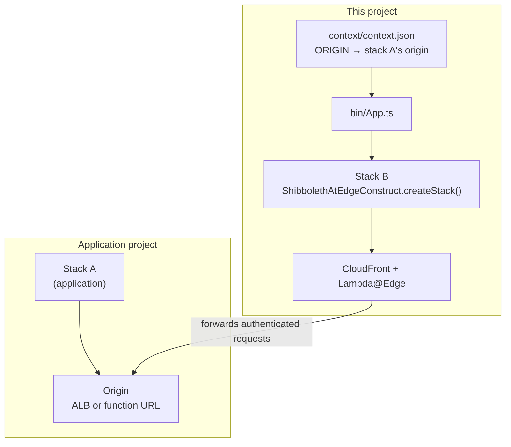
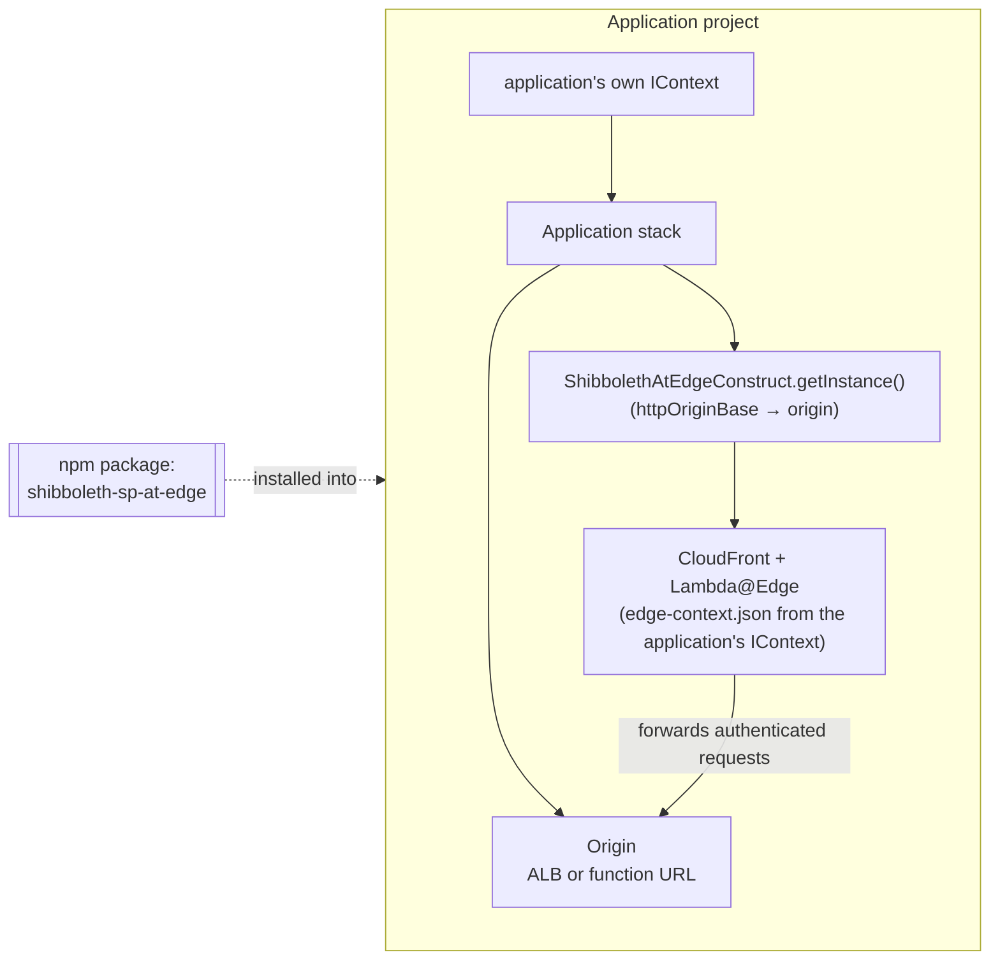

## Configuration Context

The `ShibbolethAtEdgeConstruct` is configured by a [Runtime Context](https://docs.aws.amazon.com/cdk/v2/guide/context.html) object of type `IContext` (see [IContext.ts](./IContext.ts)).
*Where* that object comes from depends on which of two deployment scenarios applies:

### Scenario 1: Standalone (loose coordination)

This project is deployed as its own CDK app ([bin/App.ts](../bin/App.ts)), producing its own stack ("stack B") that services an application stack ("stack A") deployed separately, beforehand.

- The context is read from **this project's** `./context/context.json` file.
- The `ORIGIN` section of that file points at stack A's origin: either an ALB (`originType: "alb"` + `dnsName`) or a lambda function URL (`originType: "function-url"` + `url`).
- If `ORIGIN` is omitted, or is a `function-url` without a `url`, a "dummy" lambda app is deployed as the origin instead (the **Demo** mode described [below](#overview)).
- The `npm run create-secret` / `share-secret` / `cleanup` / `get-stack-name` scripts also read their defaults from this file.



### Scenario 2: Embedded (coupled)

An application project installs this package and adds the `ShibbolethAtEdgeConstruct` to its **own** stack, alongside the origin that stack creates. Only one stack (plus the us-east-1 support stack CDK creates for Lambda@Edge, as in scenario 1) is involved.

- The application supplies its own `IContext` object. **This project's `./context/context.json` is irrelevant.**
- The application usually also passes `httpOriginBase`, the CloudFront origin it already built, so the construct doesn't build one from `ORIGIN`. Even so, `ORIGIN` should still describe that origin, because `ORIGIN.subdomain` (custom DNS) and `ORIGIN.appAuthorization` (edge-function behavior) are still read from it.
- At synth time, the construct writes the `SHIBBOLETH`, `APP_LOGIN_HEADER`/`APP_LOGOUT_HEADER` and `ORIGIN.appAuthorization` values from that object into an `edge-context.json` file deployed alongside each Lambda@Edge function. So the application's own Shibboleth settings take effect at runtime.

For example, an application stack that serves its app from a lambda function URL might do:

```typescript
import { ShibbolethAtEdgeConstruct, OriginType } from 'shibboleth-sp-at-edge';

// AuthenticatedContext is the application's own type, compatible with IContext.
// The Shibboleth construct fronts the function URL, so it needs the URL in its context.
const shibContext: AuthenticatedContext = { ...context, ORIGIN: applicationStack.modifiedContextOrigin };
await ShibbolethAtEdgeConstruct.getInstance({
  scope: applicationStack,
  id: 'shibboleth-sp-at-edge',
  context: shibContext,
  httpOriginBase: {
    originType: OriginType.FUNCTION_URL,
    httpOrigin: applicationStack.functionOrigin
  }
});
```



### The rest of this document

The fields described below apply to **both** scenarios. In scenario 1 they are the keys of `./context/context.json`. In scenario 2 they are the properties of the `IContext` object the application passes in.

In order to create IContext.ts or modify it to reflect changes to `./context/context.json` run the following:

```
cd context/
quicktype context.json -o IContext.ts
```

***NOTE**: After deployment, the ContextLog construct automatically stores a copy of the context used for the deployment in an S3 bucket (in either scenario). This allows you to retrieve the exact configuration that was used to create or update your stack, which is useful for auditing, troubleshooting, or reproducing deployments. The bucket name follows the pattern `{stack-name}-context-config-{account-id}-{region}` and contains the context file at the root level.*

#### Overview:

In scenario 2, the origin is whatever the application passes as `httpOriginBase`, so the modes below matter mainly for scenario 1. In that scenario the stack can be configured in one of two modes:

1. **Standard**: This mode sets up a [cloudfront distribution](https://docs.aws.amazon.com/AmazonCloudFront/latest/DeveloperGuide/distribution-overview.html) and a [cloudfront lambda@edge origin request function](https://docs.aws.amazon.com/AmazonCloudFront/latest/DeveloperGuide/lambda-at-the-edge.html), targeting an existing origin.
   You indicate this mode by setting the `ORIGIN.originType` value to `"alb"` in `./context/context.json`. Alternatively, set it to `"function-url"` and provide `ORIGIN.url` to target an existing lambda function URL. For an ALB, it is assumed that your origin application is serviced by a [application load balancer](https://docs.aws.amazon.com/elasticloadbalancing/latest/application/introduction.html) and providing its [arn](https://docs.aws.amazon.com/IAM/latest/UserGuide/reference-arns.html) and [dns name](https://docs.aws.amazon.com/elasticloadbalancing/latest/userguide/how-elastic-load-balancing-works.html#request-routing) is enough to "point" the cloudfront distribution at it as an origin.
2. **Demo:** This mode sets up the cloudfront distribution, lambda@edge origin request function, a "dummy" [lambda function](https://docs.aws.amazon.com/lambda/latest/dg/welcome.html), and a [function url](https://docs.aws.amazon.com/lambda/latest/dg/lambda-urls.html).
   You indicate this mode by setting the `ORIGIN.originType` value to `"function-url"` without a `url` in `./context/context.json` *(or omitting the `ORIGIN` property altogether)*.
   The intent of this mode is to deploy to AWS all of the Shibboleth SP functionality in cloudfront AND an origin "application" for it to target. The simplest and most lightweight option for this is another lambda function. This follows AWS directions on ["Using a Lambda function URL"](https://docs.aws.amazon.com/AmazonCloudFront/latest/DeveloperGuide/DownloadDistS3AndCustomOrigins.html#concept_lambda_function_url)

#### Context fields:

- STACK_ID: Used as a baseline for naming the stack and resources.
- ACCOUNT: The ID of the aws account you are deploying to.
- REGION: The region you are deploying to.
- ORIGIN: Configurations that pertain to the [application load balancer](https://docs.aws.amazon.com/elasticloadbalancing/latest/application/introduction.html) you want to target as the origin for cloudfront. *SEE: ["Using an application load balancer"](https://docs.aws.amazon.com/AmazonCloudFront/latest/DeveloperGuide/DownloadDistS3AndCustomOrigins.html#concept_elb_origin) and ["Restricting access to Application Load Balancers"](https://docs.aws.amazon.com/AmazonCloudFront/latest/DeveloperGuide/restrict-access-to-load-balancer.html)*
  - originType: `"alb"` or `"function-url"`.
  - url: *(function-url only)* The URL of an existing lambda function URL to target. Omit it to get the Demo mode's dummy app.
  - dnsName: *(alb only)* The [dns name](https://docs.aws.amazon.com/elasticloadbalancing/latest/userguide/how-elastic-load-balancing-works.html#request-routing) of the ALB targeted as the origin.
  - stackId: Indicates a unique identifier for the cloudfront origin that the lambda@edge functions intercept traffic for. This value will form part of the name of the secrets manager secret created for this stack and thereby provide a clue as to the origin the secrets are applicable to.
  - arn: The [Amazon resource name](https://docs.aws.amazon.com/IAM/latest/UserGuide/reference-arns.html) of the ALB,
  - subdomain: If the cloudfront distribution through which requests are to pass to reach the origin is to be associated with custom DNS using Route53 and a Certificate, this value specifies a subdomain of that hosted zone. For example, if the hosted zone is `mydomain.com`, the this value would be something like `mysubdomain.mydomain.com`
  - httpPort: The port the ALB will be listening on for incoming http requests.
  - httpsPort: The port the ALB will be listening on for incoming https requests.
  - appAuthorization: This serves as a boolean that indicates a mode of operation for the origin request function:
    - "true": *default*, requests are passed through to the origin which decides if that request needs to be kicked back to shibboleth for authentication
    - "false": The origin request function requires ALL incoming requests to show evidence of having authenticated with shibboleth before passing through to the origin.
- APP_LOGIN_HEADER: The name of the http header that the origin application will reference for a value that indicates the redirect path for authentication. If a request to an app endpoint that needs to be private is missing an authentication token ([JWT](https://jwt.io/introduction)) the app will redirect to the path indicated by this header value.
- APP_LOGOUT_HEADER: The name of the http header that the origin application will reference for a value that indicates the redirect path for logging off with shibboleth. This will accomplish wiping out any headers that were created by shibboleth and landing on a signout page. *(NOTE): The origin request lambda function will also invalidate the JWT created the user first authenticated.*

- CLOUDFRONT_CACHING_STRATEGY: This value indicates the caching strategy that the cloudfront distribution should apply. Options are:
  - "no-cache": *default*, Cloudfront will not cache any content from the origin. Every request will be passed through to the origin.
  - "standard": Cloudfront will apply a typical caching strategy.
  - "bu-cache": Cloudfront will apply a caching strategy customized for BU websites.
- SHIBBOLETH:
  - entityId: The ID of your application service provider
  - idpCert: The public key as published by shibboleth at the IDP entity ID endpoint.
    For example, this would be the `<EntityDescriptor>.<IDPSSODescriptor>.<KeyDescriptor>.<ds:KeyInfo>.<ds:X509Data>.<ds:X509Certificate>` value at [https://shib-test.bu.edu/idp/shibboleth](https://shib-test.bu.edu/idp/shibboleth) for the shibboleth test IDP
  - entrypoint: The redirect binding published by shibboleth at the IDP entity ID endpoint.
    For example, this would be the  `<EntityDescriptor>.<IDPSSODescriptor>.<KeyDescriptor><SingleSignOnService>` value at [https://shib-test.bu.edu/idp/shibboleth](https://shib-test.bu.edu/idp/shibboleth) for the shibboleth test IDP
  - logoutUrl: The "SLO" value as documented by the techweb [Configuration Information for Application Admins](https://www.bu.edu/tech/services/security/iam/authentication/shibboleth/configuration/) page. This is the url redirected to by  your app for logging out with shibboleth
  - secret:
    All the private keys and certs are stored in secrets manager
    - secretArn: The AWS [ARN](https://docs.aws.amazon.com/IAM/latest/UserGuide/reference-arns.html) of the [secrets manager](https://docs.aws.amazon.com/secretsmanager/latest/userguide/intro.html) secret where the private keys and certs are stored.
    - refreshInterval: The lambda@edge origin request function caches the secret to avoid having to perform a secrets manager lookup for each request. This cache is refreshed at an interval specified by this value in milliseconds.
    - samlCertSecretFld: The [Service Provider Checklist](https://www.bu.edu/tech/services/security/iam/authentication/shibboleth/service-provider-checklist/) techweb form requires you to provide a "Service Provider Metadata" xml file to register your app as a service provider with shibboleth. Shibboleth requires a public portion of a certificate keypair to be provided in this file at `<md:EntityDescriptor>.<md:SPSSODescriptor>.<md:KeyDescriptor>.<ds:KeyInfo>.<ds:X509Data>.<ds:X509Certificate>`. This field is that public certificate value.
    - samlPrivateKeySecretFld: This is the private key that matches the samlCertSecretFld certificate.
    - jwtPublicKeySecretFld: This is the public portion of a RSA keypair. It is used in signing the [JSON web token (JWT)](https://jwt.io/introduction) by the Lambda@edge origin request function. [Example for generating this key](https://www.npmjs.com/package/node-forge#rsa)
    - jwtPrivateKeySecretFld: This is the private counterpart of jwtPublicKeySecretFld

#### Example:

```
{
  "STACK_ID": "shibsp",
  "ACCOUNT": "037860335094",
  "REGION": "us-east-2",
  "ORIGIN": {
    "originType": "alb",
    "arn": "arn:aws:elasticloadbalancing:us-east-2:037860335094:loadbalancer/app/wp-wp-alb-questrom/ee233355a7e666a9",
    "dnsName": "wp-wp-alb-questrom-1436663317.us-east-2.elb.amazonaws.com",
    "httpPort": 80,
    "httpsPort": 443,
    "subdomain": "questrom.warhen.work",
    "appAuthorization": true
  }, 
  "DNS": {
    "hostedZone": "warhen.work",
    "certificateARN": "arn:aws:acm:us-east-1:037860335094:certificate/47aadc38-fe33-4519-932a-10c6ababaccc"
  } ,
  "APP_LOGIN_HEADER": "SHIB-HANDLER",
  "APP_LOGOUT_HEADER": "SHIB-IDP-LOGOUT",
  "SHIBBOLETH": {
    "entityId": "https://*.kualitest.research.bu.edu/shibboleth",
    "idpCert": "MIIDPDCCAiSgAwIBAgIVAJ6eiJuZK4QyWfKYUqfJdhx4wzkPMA0GCSqGSIb3DQEBBQUAMB8xHTAbBgNVBAMTFHdlYmxvZ2luLXRlc3QuYnUuZWR1MB4XDTEwMDkxNTE0Mjg0OFoXDTMwMDkxNTE0Mjg0OFowHzEdMBsGA1UEAxMUd2VibG9naW4tdGVzdC5idS5lZHUwggEiMA0GCSqGSIb3DQEBAQUAA4IBDwAwggEKAoIBAQCI5moQtXWSwpI/nt/fppWlIh4KDpF7AoetWTiSekjj6rQNIAVV1BiTGjvcPSsQzdEJZKpgO6tjMxPi8UiP8yXgcklzgsrHHGuIlQt6dwZNgS9IxkDnNTn8YqHoFoIm1v/po34qFERVzAo2n8SphHz3Pfp5BBH/Xc2q/IHxtBbSlhszx+2qYCzUuIVgONR+dN63ZmoRYoEakjosuTHxSqHxTXrPpE01FLCEfMXJlploh6ZrV96Y5pScMnn8ULr0Sgsq8x4qCDP2llEXRAsn/WWpzzmTFxGezzXgA2OQLeDMbq6SqmZ7E7dNEu244E9l1JnHLQBsPe9PXP/QEV7h+f/5AgMBAAGjbzBtMEwGA1UdEQRFMEOCFHdlYmxvZ2luLXRlc3QuYnUuZWR1hitodHRwczovL3dlYmxvZ2luLXRlc3QuYnUuZWR1L2lkcC9zaGliYm9sZXRoMB0GA1UdDgQWBBTPzLtx4wmThF7g6C3eCj6zw4tfszANBgkqhkiG9w0BAQUFAAOCAQEAC3lmttoHGXIHfEL75ViI8EyQD44J+bKIYTvbvQmBLS7Lw4iNgalmHnOgs5RBB5oIzOVWgeRUv0bwl48Gp4F9k7cXXDTwZRUxYc6kV9d/dEOCyOEDl4cDhsbM/TJJHPOVLhhPJXec07b3qxb4SaU/YP0ZiE+zD4FqikvZYkD20blmDIJbKPZvBlqfYZ0bBEdnKbWRH8uvFxgm1cz3+azzIWjqGXc7259shmJc391vNwva8SzJG9mUghTKGW1tdu3uoF6tIf/a3sUPxL+z0F0newS75gUl4ccWCjO4TuDgfyJEcjIZ0CYyIvzmtiWg7ZJxvG0zzYcx1ps3hT3nP38erw==",
    "entryPoint": "https://shib-test.bu.edu/idp/profile/SAML2/Redirect/SSO",
    "logoutUrl": "https://shib-test.bu.edu/idp/logout.jsp",    
    "secret": {
      "secretArn": "arn:aws:secretsmanager:us-east-2:037860335094:secret:dev/wp/shib-sp-test-JML3FN",
      "refreshInterval": "3600000",
      "samlPrivateKeySecretFld": "wp-sp-key",
      "samlCertSecretFld": "wp-sp-cert",
      "jwtPrivateKeySecretFld": "wp-jwt-prikey",
      "jwtPublicKeySecretFld": "wp-jwt-pubkey",
      "cloudfrontChallengeSecretFld": "cloudfront-challenge"
    }
  },
  "TAGS": {
    "Service": "websites",
    "Function": "wordpress",
    "Landscape": "questrom"
  }
}
```

